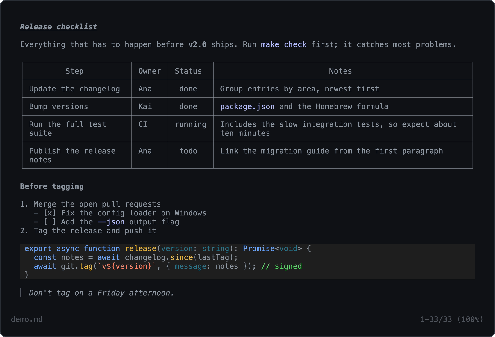

<h1 align="center">md</h1>

<p align="center">
  <a href="LICENSE"></a><br>
  Markdown in your terminal, the way Claude Code shows it.
</p>

<p align="center">
  <a href="#key-features">Key features</a> •
  <a href="#how-to-use">How to use</a> •
  <a href="#installation">Installation</a> •
  <a href="#customization">Customization</a> •
  <a href="#project-goals-and-alternatives">Project goals, alternatives</a>
</p>



`md` renders markdown files in the terminal with the same look as Claude Code's replies: box-drawn tables that fit the window, highlighted code, clickable links. It opens them in a full-screen viewer with search, and stays fast on large files.

## Key features

### Tables that fit

Tables get proper box borders and squeeze into whatever width your terminal has. Long cells wrap inside their column instead of running off the edge. And if a table really can't fit (say one of the cells is a whole essay), `md` gives up on the box and prints every row as `Header: value` lines instead.

### Syntax highlighting

Code blocks are highlighted with [highlight.js](https://highlightjs.org), in the same colours Claude Code uses, so around 190 languages are covered. Each language is loaded the first time a code block needs it, so you don't pay for all 190 of them on every run.

### A full-screen viewer

In a terminal, `md` opens the document full screen. You can scroll with the keyboard or the mouse wheel, search with `/`, and resize the window as much as you like; everything re-wraps to the new width.

| Keys | |
|------|---|
| `j` `k` `↑` `↓`, scroll wheel | Scroll by line (the wheel moves three) |
| `space` `b`, `PgDn` `PgUp` | Scroll by screen |
| `d` `u` | Scroll by half a screen |
| `g` `G`, `Home` `End` | Top / bottom |
| `/` | Search |
| `n` `N` | Next / previous match |
| `esc` | Clear the search, or quit |
| `?` | Help |
| `q` | Quit |

Search looks for plain text, not a regex, and ignores case unless you type a capital letter.

### Big files

`md` lays out only what's on the screen and does the rest in the background. Until that's done, the footer shows approximate line numbers, marked with `~`. On a 720 KB file the first screen shows up after about 110 ms, and a resize takes about 1 ms.

### Printing

With `-p`, or whenever the output goes to a pipe or a file, `md` just prints the rendered document, so you can use it pretty much the way you'd use `cat`.

## How to use

Open a file:

```sh
md README.md
```

Print it instead of opening the viewer:

```sh
md -p README.md
```

Read from stdin:

```sh
cat notes.md | md
```

Render at a fixed width, for example when printing for something narrower than your terminal:

```sh
md -p -w 80 CHANGELOG.md
```

### Integration with other tools

#### `git`

Read an older version of a document:

```sh
git show v1.0.0:README.md | md
```

#### `curl`

Read a README without cloning the repository:

```sh
curl -s https://raw.githubusercontent.com/bibixx/md/main/README.md | md
```

## Installation

There are no packages yet, so for now it's from source. You'll need [Bun](https://bun.sh) 1.4 or newer.

```sh
git clone https://github.com/bibixx/md.git
cd md
bun install
bun link
```

`bun link` puts `md` in `~/.bun/bin`, pointing at your checkout, so updating is just a `git pull`.

## Customization

### Configuration file

`md` reads `~/.config/md/config.json` (or `$XDG_CONFIG_HOME/md/config.json` if you set that). These are the defaults:

```json
{
  "padding": { "top": 1, "bottom": 1, "left": 2, "right": 2 },
  "codePadding": { "left": 1, "right": 1 },
  "tabWidth": 2
}
```

`padding` is the space around the whole document: blank lines above and below, and spaces on the left and right. `codePadding` is the same thing inside a code block's background. Both take `vertical` and `horizontal` as shorthands, and a specific side wins over a shorthand. `tabWidth` is how far apart tab stops are in code.

### Light and dark

`md` guesses whether your terminal is light or dark from the `COLORFGBG` variable (iTerm2 and a few others set it), and goes with dark if it can't tell. If it guesses wrong, pass `--light` or `--dark`.

### Command-line options

```
-p, --print        print instead of opening the viewer
-w, --width N      render at N columns (default: terminal width, or 100 when piped)
    --light        light theme colours
    --dark         dark theme colours
    --no-color     plain text
-h, --help         show the help
```

## Troubleshooting

### Selecting text in the viewer

The viewer listens to the mouse so the scroll wheel works, and that gets in the way of selecting text. Most terminals let you get around it with a modifier: <kbd>Option</kbd>+drag in iTerm2, <kbd>Shift</kbd>+drag in most others. Or quit and use `md -p`.

### No colours

That's on purpose when the output isn't a terminal. Set `FORCE_COLOR=3` if you want them anyway.

## Project goals and alternatives

`md` tries to:

- look like Claude Code, as closely as makes sense for files
- stay fast, even on files much bigger than anything you'd write by hand

Some things are different from Claude Code on purpose, mostly because a file isn't a chat reply. Single newlines inside a paragraph turn into spaces, so hard-wrapped files reflow. Tables that wrap use the whole width. Code, quotes and tables inside list items are indented under the item. Horizontal rules are drawn as a grey line, HTML comments are grey, and code blocks get a faint background. The full list (plus what's still waiting to be compared side by side) is in [`fixtures/README.md`](fixtures/README.md).

If you're after something more established, [glow](https://github.com/charmbracelet/glow) is the one most people know, and it comes with a nice file browser. There's also [treemd](https://github.com/Epistates/treemd), [md-tui](https://github.com/henriklovhaug/md-tui), and [mdfried](https://github.com/benjajaja/mdfried), which can even show images.

`md` isn't affiliated with or endorsed by Anthropic.

## Development

```sh
bun test                       # unit and snapshot tests
bun test --update-snapshots    # accept intended changes to the rendered output
bun bin/md.mjs fixtures/05-code.md
vhs docs/screenshot.tape       # regenerate the screenshot above (needs VHS)
```

Every file in `fixtures/` is rendered and compared with a saved snapshot, so any change to how something looks fails a test until the snapshot is updated. Review the snapshot diff before committing. [`AGENTS.md`](AGENTS.md) explains how the rendering pipeline fits together.

## License

[MIT](LICENSE)
